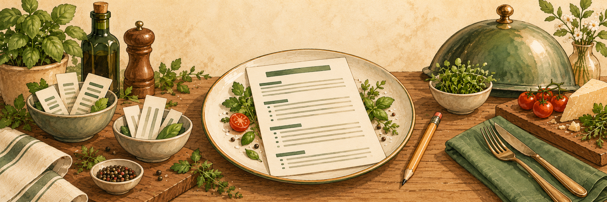
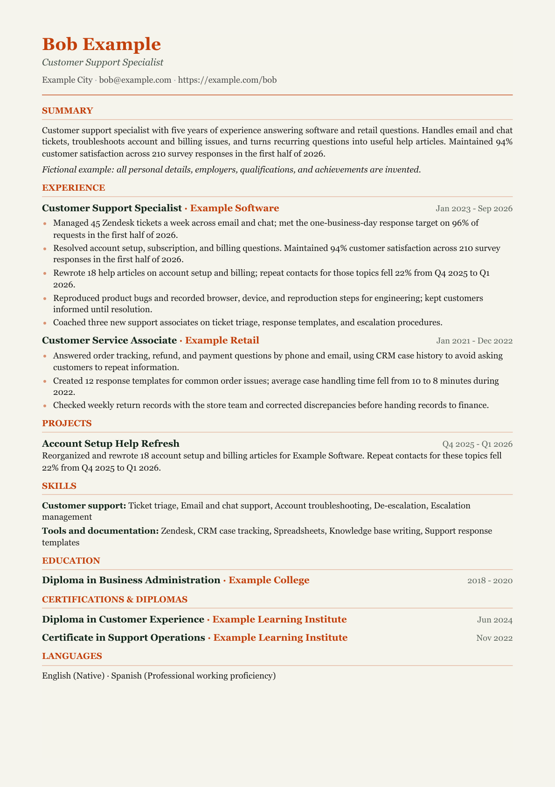

# 🍊 CV Kitchen

<p align="center">
  
</p>

<p align="center">
  <a href="LICENSE"></a>
  <a href="skills/cv-kitchen/SKILL.md"></a>
  <a href="dist/cv-kitchen-skill.zip?raw=true"></a>
  <a href="examples/bob/resume.pdf"></a>
</p>

**Fine-dining care for your next CV.**

Bring your experience; we'll help plate it clearly. CV Kitchen is an AI skill that interviews you one question at a time, tailors verified facts to a role, and delivers a complete, ATS-readable CV with warm orange accents. Relevant projects and professional certificates or diplomas can join the menu, when you have them.

[See Bob's example CV (PDF)](examples/bob/resume.pdf) · [Download the skill](dist/cv-kitchen-skill.zip?raw=true). Bob and every career detail in the example are fictional.

## 🍳 Install

Install for Codex and Claude Code with one command:

```sh
npx --yes skills@latest add kalricdev/cv-kitchen --skill cv-kitchen -a codex -a claude-code -g -y
```

The [Vercel skills CLI](https://github.com/vercel-labs/skills) requires Node.js and installs the skill globally for both agents. If the repository is private, your GitHub account needs access.

Codex and Claude Code are agents; their installation is separate from ChatGPT and Claude browser chat.

## 💬 Use in your browser

| Assistant | Install or load |
| --- | --- |
| Gemini | [Download the ZIP](dist/cv-kitchen-skill.zip?raw=true), then Settings → Skills → Upload |
| Claude | [Download the ZIP](dist/cv-kitchen-skill.zip?raw=true), then Customize → Skills → + Create skill → Upload a skill |
| ChatGPT | [Open SKILL.md](skills/cv-kitchen/SKILL.md?raw=true), then paste its full text or attach the file to your chat |

Gemini skills need no paid Google AI subscription on eligible personal accounts; availability rolls out gradually. If upload is unavailable, paste the skill text. See the official [Gemini](https://support.google.com/gemini/answer/17094296?hl=en) and [Claude](https://support.claude.com/en/articles/12512180-use-skills-in-claude) instructions.

Use your existing free or paid assistant access. Account limits and document tools vary; CV Kitchen needs no paid API integration.

## 🥕 Start your CV

> Use CV Kitchen to build an ATS-ready CV. Ask one question at a time.

Bring your existing CV or verified career facts, your preferred document language, and the full job posting when tailoring. The skill improves wording, identifies gaps, and uses relevant keywords only when your experience supports them.

You receive a complete CV and, when document tools are available, a DOCX or text-based PDF with burnt-orange headings and readable dark body text. Your required submission format takes priority. Without file tools, you receive polished text ready to copy.

Projects and certificates, diplomas, or professional-development courses are optional. Include verified, relevant entries; omit empty sections. A course diploma is described as that credential, never upgraded into a degree.

The CV keeps conventional headings, a single column, clear dates, and real body text. It avoids tables, photos, icons, text boxes, and contact details in headers. These choices reduce parsing problems; they cannot guarantee acceptance by every ATS.

Share authorized information only. Redact private contact details and confidential evidence before sending files to an assistant.

## 📄 A serving suggestion

<a href="examples/bob/resume.pdf"></a>

[Read Bob's CV text](examples/bob/resume.md). The example shows the optional sections; your CV includes only what is relevant and verified.

## 🙏 Credits

- [kalricdev](https://github.com/kalricdev) created CV Kitchen and its original skill.
- [Matt Pocock's skills](https://github.com/mattpocock/skills) inspired the simple installation approach; [Vercel skills](https://github.com/vercel-labs/skills) provides the installer.
- [Reactive Resume](https://github.com/amruthpillai/reactive-resume) inspired the optional structured-data format; [Kami](https://github.com/tw93/Kami) inspired the parchment and serif styling.
- The original hero and mascot were generated with imagegen; [source prompts](assets/image-prompts.md) are included.

[MIT licensed](LICENSE) · [Full credits](CREDITS.md) · [Usage prompts](docs/ai-setup.md) · [Contributing](CONTRIBUTING.md)
